MANUAL DE UTILIZAÇÃO DO SISTEMA INFOTREM
Sistema: InfoTrem – Tecnologia em Movimento
Versão: 1.0
Ano: 2026
Local: Joinville – SC

Este documento reúne as orientações de utilização do InfoTrem para os dois perfis de acesso: Administrador e Usuário. Consulte a seção correspondente ao perfil da sua conta.
PARTE I — PERFIL ADMINISTRADOR
MANUAL DE UTILIZAÇÃO DO SISTEMA INFOTREM

PERFIL: ADMINISTRADOR

Sistema: InfoTrem – Tecnologia em Movimento

Versão: 1.0

Ano: 2026

Local: Joinville – SC

1. APRESENTAÇÃO DO SISTEMA
O InfoTrem é um sistema desenvolvido para auxiliar no gerenciamento e monitoramento ferroviário. A plataforma permite organizar informações relacionadas aos usuários, trens, rotas e sensores, além de disponibilizar recursos para acompanhar informações operacionais.

O sistema possui diferentes níveis de acesso, sendo eles Administrador e Usuário. Cada perfil possui permissões específicas, de acordo com suas responsabilidades.

O administrador possui acesso às funcionalidades de gerenciamento, podendo realizar cadastros, consultar informações, editar e excluir registros disponíveis no sistema.

Este manual apresenta o passo a passo para utilizar as principais funcionalidades disponíveis no perfil Administrador.

1.1Página inicial pública (Landing Page)
Antes de realizar o login, o visitante pode visualizar a página pública do InfoTrem, também chamada de landing page. Essa página apresenta o propósito do projeto e explica, de forma resumida, a proposta da plataforma: organizar, gerenciar e monitorar informações ferroviárias com apoio de tecnologia e Internet das Coisas (IoT).

Na parte superior, a página destaca a mensagem “Mais controle e tecnologia para o transporte ferroviário”, acompanhada de um botão “Conheça o sistema”. Esse botão funciona como um convite para que o visitante avance e conheça melhor a solução.

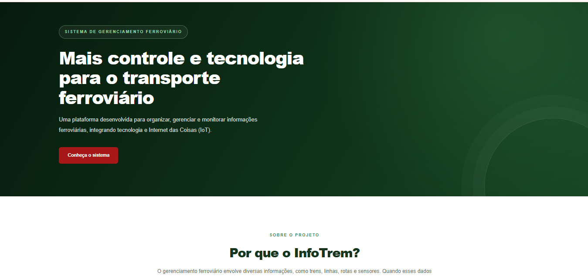

Ao continuar a navegação, a seção “Por que o InfoTrem?” contextualiza a necessidade de centralizar informações de trens, linhas, rotas e sensores. Em seguida, a seção “O que o sistema oferece?” apresenta os recursos da plataforma. Assim, a landing page tem função institucional e informativa: apresentar o projeto antes do acesso à área restrita.

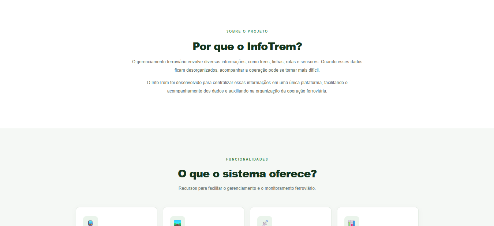

2. COMO ACESSAR O SISTEMA

O acesso ao InfoTrem é realizado por meio do XAMPP, que disponibiliza o servidor local necessário para executar o sistema no computador.

Abra o Painel de Controle do XAMPP.

Inicie os módulos Apache e MySQL, utilizados para executar o sistema e sua base de dados.

Verifique se os módulos iniciados aparecem como ativos no painel do XAMPP.

Com os serviços ativos, abra um navegador e acesse o endereço local configurado para o projetoInfoTrem.

Quando a tela de acesso for exibida, informe as credenciais de uma conta cadastrada para continuar.

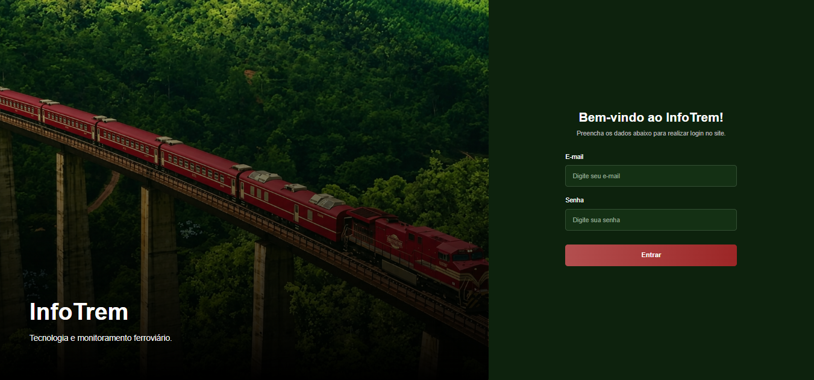

3. COMO REALIZAR O LOGIN

O login é o procedimento utilizado para identificar o usuário e permitir o acesso às funcionalidades correspondentes ao seu tipo de conta.

Na tela de acesso, localize os campos destinados ao e-mail e à senha.

Localize o campo E-mail.

Digite o endereço de e-mail cadastrado para a conta de administrador.

Localize o campo Senha e digite a senha correspondente à conta.

Confira se as informações foram preenchidas corretamente.

Clique no botão Entrar.

Após a validação das informações, o sistema direcionará o administrador para a página inicial.

Caso os dados estejam incorretos, o acesso não será realizado. Confira as informações digitadas e tente novamente.

4. CONHECENDO A PÁGINA INICIAL

Após realizar o login, o administrador será direcionado à página inicial do InfoTrem. Nessa tela, são apresentadas informações gerais do sistema e atalhos para acessar algumas das principais funcionalidades.

4.1. Mensagem de boas-vindas
Na parte superior da página, aparece uma mensagem de boas-vindas que identifica o perfil conectado ao sistema.

4.2. Acessos rápidos
A página inicial apresenta cartões de acesso rápido para as áreas de Sensores, Trens e Rotas. Ao selecionar um desses cartões, o administrador é direcionado à área correspondente para consultar ou gerenciar os registros.

4.3. Clima atual
O cartão Clima atual apresenta informações meteorológicas referentes à cidade de Joinville – SC. Nele podem ser visualizadas:

Temperatura atual em graus Celsius (°C).

Condição climática, como nublado.

Umidade do ar.

Data e horário da última atualização.

Fonte das informações meteorológicas.

As informações são apresentadas para consulta e podem sofrer alterações conforme as atualizações dos dados climáticos.

4.4. Usuários do sistema e controle geral
O cartão Usuários do sistema apresenta um resumo da quantidade de usuários e administradores cadastrados, além do total de contas no sistema.

Na área Controle geral, são exibidas as quantidades de rotas, trens e sensores cadastrados. Esses indicadores permitem consultar rapidamente o volume de registros existentes.

5. NAVEGAÇÃO PELO MENU LATERAL

O menu lateral fica localizado no lado esquerdo da tela e permite acessar as principais áreas do sistema. As opções identificadas nas telas do perfil Administrador são:

Início: retorna à página inicial do sistema.

Adicionar usuário: direciona para a área de cadastro e gerenciamento de contas.

Rotas: permite acessar a área de cadastro e consulta das rotas ferroviárias.

Trens: permite acessar a área de cadastro e consulta dos trens.

Sensores: permite acessar a área de cadastro e consulta dos sensores.

Monitoramento: direciona para a tela de acompanhamento das informações dos sensores e trens.

Sair: permite encerrar a sessão atual.

Para acessar uma dessas áreas, basta clicar sobre a opção desejada.

6. CADASTRO E GERENCIAMENTO DE USUÁRIOS

O gerenciamento de usuários permite ao administrador cadastrar novas contas, consultar os registros existentes, atualizar informações e administrar os acessos ao sistema.

6.1. Como cadastrar um usuário
Para realizar um novo cadastro:

No menu lateral, clique em Adicionar usuário.

Aguarde a abertura da tela Cadastrar Usuário.

No campo Nome completo, informe o nome da pessoa que será cadastrada.

No campo CPF, digite o número do documento.

Em Data de nascimento, informe a data de nascimento do usuário.

No campo E-mail, informe um endereço de e-mail.

Em Telefone, informe o número de contato.

No campo CEP, informe o código postal.

Em Logradouro, digite o nome da rua ou avenida.

No campo Bairro, informe o bairro correspondente.

Em Cidade, informe a cidade do usuário.

No campo Estado (UF), informe a sigla do estado.

Em Senha inicial, crie uma senha para o acesso.

No campo Tipo de conta, selecione Administrador ou Usuário.

Em Status da conta, selecione a situação da conta.

Confira todas as informações preenchidas e clique em Cadastrar usuário.

Após o cadastro, o sistema deverá registrar as informações fornecidas.

6.2. Tipos de conta
Durante o cadastro, o administrador deverá selecionar o tipo de conta que será atribuído à pessoa:

Administrador: possui permissões de gerenciamento do sistema.

Usuário: possui acesso às funcionalidades disponibilizadas para o perfil comum.

A escolha do tipo de conta determina quais funcionalidades estarão disponíveis para cada pessoa.

6.3. Status da conta
O campo Status da conta permite definir a situação do cadastro:

Ativo: indica que a conta está habilitada.

Inativo: indica que a conta está desativada.

6.4. Como consultar usuários cadastrados
Acesse a área de usuários por meio da opção Adicionar usuário.

Na tela de cadastro, utilize o botão Visualizar Usuários Cadastrados para abrir a listagem.

Consulte os indicadores apresentados no início da página, que resumem a quantidade de funcionários, administradores, usuários e usuários ativos.

Se necessário, digite um nome ou e-mail no campo de pesquisa.

Utilize os filtros Tipo de conta e Status para refinar a consulta.

Clique em Filtrar para aplicar os critérios. Para retirar os filtros, clique em Limpar filtros.

Localize o registro desejado na tabela.

A tabela apresenta as colunas ID, Nome, E-mail, Telefone, Endereço, Data de Nascimento, CPF, Tipo de conta, Status e Ações. O CPF aparece parcialmente oculto na listagem.

6.5. Como editar um usuário
Na listagem, localize a conta que deseja modificar.

Clique no ícone de edição correspondente ao registro.

Aguarde a abertura da tela Editar Usuário.

Atualize os campos necessários, como nome, e-mail, telefone, data de nascimento e endereço.

Se desejar alterar a senha, preencha o campo Nova senha. Caso contrário, deixe-o vazio para manter a senha atual.

Confira os campos Cargo e Status e altere-os, se necessário.

Após revisar as informações, clique em Editar usuário para salvar as alterações.

6.6. Como excluir um usuário
Acesse a listagem de usuários cadastrados.

Localize a conta que deseja excluir.

Clique no ícone de exclusão correspondente ao registro.

Confira se o usuário selecionado está correto.

Confirme a operação, caso o sistema apresente uma solicitação de confirmação.

A exclusão deve ser realizada com atenção, pois pode afetar o acesso da pessoa ao sistema.

7. CADASTRO E GERENCIAMENTO DE ROTAS

A área de rotas permite organizar os trajetos ferroviários, relacionando estações de origem e destino aos trens cadastrados.

7.1. Como cadastrar uma rota
Acesse a opção Rotas pelo menu lateral.

Na área de rotas, localize a opção de cadastro de uma nova rota.

No campo Nome da rota, informe o nome que identificará o trajeto.

Em Trem vinculado, selecione o trem relacionado à rota.

No campo Estação de origem, informe a estação inicial.

Em Estação de destino, informe a estação final.

No campo Distância total (km), informe a distância do percurso.

Em Tempo previsto de viagem, informe a duração estimada do trajeto.

No campo Descrição da rota, apresente características ou informações adicionais sobre o percurso.

Revise os dados e clique em Cadastrar rota.

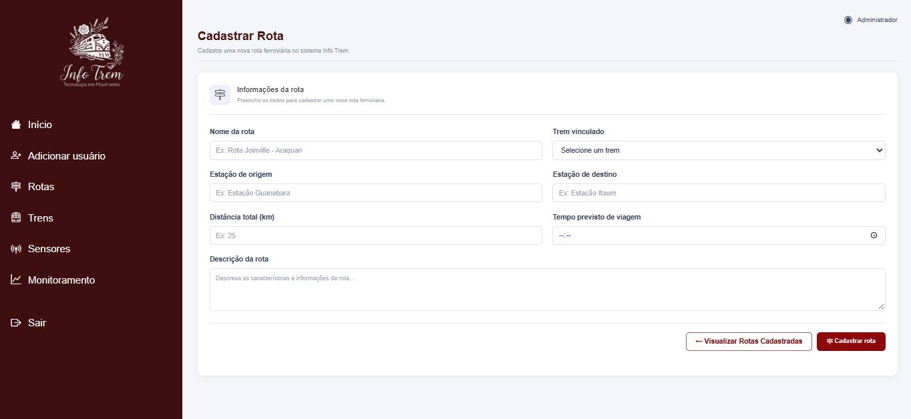

7.2. Como consultar rotas cadastradas
Na área de Rotas, acesse a opção Visualizar Rotas.

Utilize o campo Pesquisar rotas para localizar um registro, se necessário.

Clique em Pesquisar.

Consulte os dados apresentados na tabela.

A listagem apresenta as colunas ID, Estação de Origem, Estação de Destino, Distância, Descrição, Tempo Estimado, Trem vinculado e Ações. O botão + Nova Rota permite iniciar um novo cadastro.

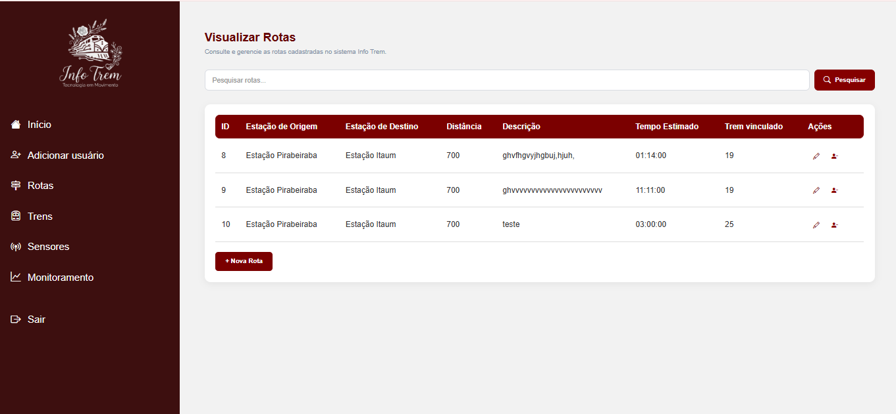

7.3. Como editar uma rota
Na listagem de rotas, localize o registro que deseja modificar.

Clique no ícone de edição correspondente.

Aguarde a abertura da tela Editar Rota.

Atualize os campos necessários: nome da rota, trem vinculado, estação de origem, estação de destino, distância, tempo previsto e descrição.

Confira as informações e clique em Editar Rota para salvar as alterações.

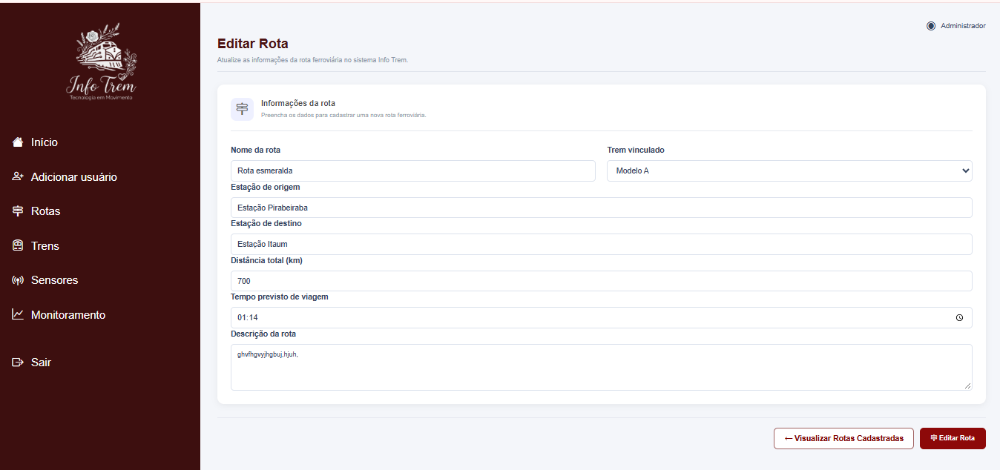

7.4. Como excluir uma rota
Acesse a listagem de rotas.

Localize a rota que deseja remover.

Clique na opção de exclusão correspondente.

Confira as informações da rota selecionada.

Confirme a operação, caso o sistema solicite.

Antes de excluir uma rota, verifique se existem sensores vinculados a ela.

8. CADASTRO E GERENCIAMENTO DE TRENS

A área de trens permite registrar, consultar e atualizar as informações dos veículos ferroviários cadastrados no InfoTrem.

8.1. Como cadastrar um trem
Acesse a opção Trens pelo menu lateral.

Na tela de trens, selecione a opção para cadastrar um novo trem.

No campo Modelo do trem, informe o modelo do veículo.

Em Velocidade limite (km/h), informe a velocidade máxima correspondente.

No campo Linha, informe a linha ferroviária relacionada.

Em Carga transportada, informe o tipo de carga transportada pelo trem.

No campo Usuário vinculado, selecione o usuário relacionado ao registro.

Confira todas as informações e clique em Cadastrar trem.

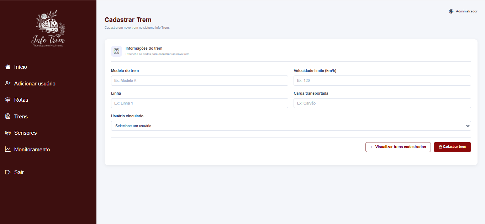

8.2. Como consultar os trens cadastrados
Acesse a área de Trens.

Utilize o campo Pesquisar trens para localizar um registro, se necessário.

Clique em Pesquisar.

Consulte as informações organizadas na tabela.

A listagem apresenta as colunas ID, Modelo, Velocidade, Linha, Carga, Usuário e Ações. O botão + Novo Trem permite iniciar outro cadastro.

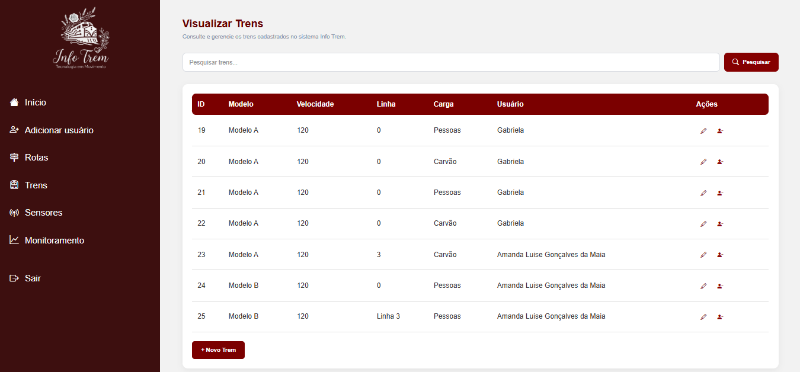

8.3. Como editar um trem
Na listagem de trens, localize o registro que deseja modificar.

Clique no ícone de edição correspondente.

Aguarde a abertura da tela Editar Trem.

Atualize os campos Modelo do trem, Velocidade limite, Linha, Carga transportada e Usuário vinculado.

Confira as informações e clique em Editar Trem para salvar as alterações.

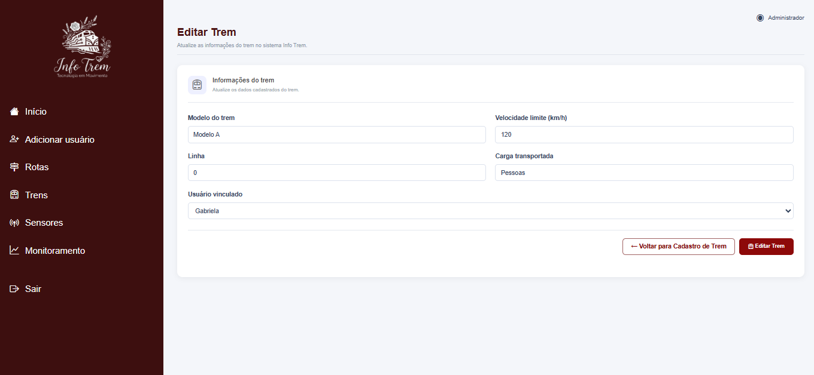

8.4. Como excluir um trem
Acesse a listagem de trens.

Localize o registro desejado.

Clique na opção de exclusão correspondente.

Confira se selecionou o trem correto.

Confirme a operação, caso seja solicitada.

Antes de excluir um trem, verifique se ele está relacionado a alguma rota.

9. CADASTRO E GERENCIAMENTO DE SENSORES

Os sensores são utilizados para registrar informações relacionadas à operação ferroviária. No InfoTrem, o administrador pode cadastrar sensores, vinculá-los às rotas e definir qual tipo de dado será monitorado.

9.1. Como cadastrar um sensor
Acesse a opção Sensores pelo menu lateral.

Na tela de sensores, selecione a opção para cadastrar um novo sensor.

No campo Nome do sensor, informe o nome ou a identificação do dispositivo.

Em Rota vinculada, selecione a rota à qual o sensor estará associado.

No campo Descrição da localização, informe onde o sensor está instalado.

Em Tipo do dado monitorado, informe qual informação será acompanhada, como temperatura ou velocidade.

Confira os dados preenchidos e clique em Cadastrar Sensor.

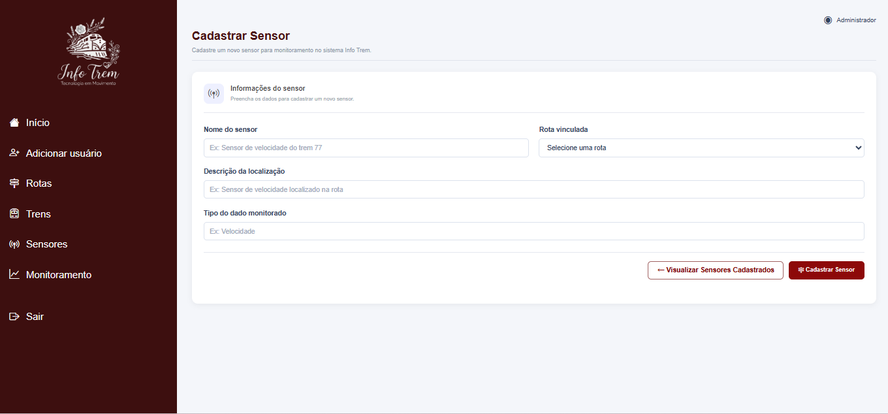

9.2. Como consultar sensores cadastrados
Acesse a área de Sensores.

Utilize o campo Pesquisar sensores para localizar um registro, se necessário.

Clique em Pesquisar.

Consulte as informações apresentadas na tabela.

A listagem apresenta as colunas ID, Nome, Rota vinculada, Descrição da localização, Dado Monitorado e Ações. O botão + Novo Sensor permite iniciar um novo cadastro.

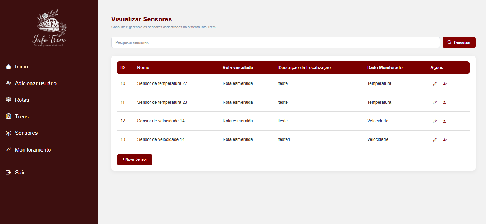

9.3. Como editar um sensor
Na listagem de sensores, localize o registro que deseja modificar.

Clique no ícone de edição correspondente.

Aguarde a abertura da tela Editar Sensor.

Atualize o Nome do sensor, a Rota vinculada, a Descrição da localização ou o Tipo do dado monitorado, conforme necessário.

Confira as informações e clique em Editar sensor para salvar as alterações.

Retorne à listagem para verificar o registro atualizado.

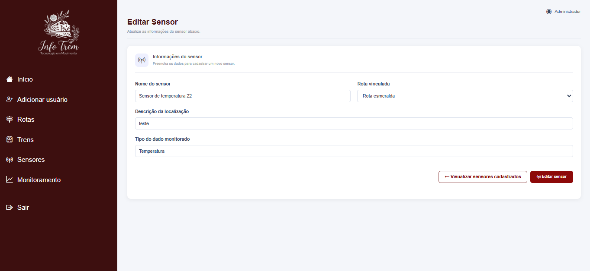

9.4. Como excluir um sensor
Acesse a listagem de sensores.

Localize o sensor que deseja remover.

Clique na opção de exclusão correspondente.

Confira se o registro selecionado está correto.

Confirme a operação, caso o sistema solicite.

Antes de excluir um sensor, verifique se existem informações ou registros relacionados a ele

10. MONITORAMENTO FERROVIÁRIO

A funcionalidade Monitoramento permite visualizar informações relacionadas aos sensores e aos trens cadastrados no InfoTrem.

Localize o menu lateral.

Clique em Monitoramento.

Aguarde o carregamento da página.

Observe os cartões de sensores, a tabela de trens e os gráficos apresentados.

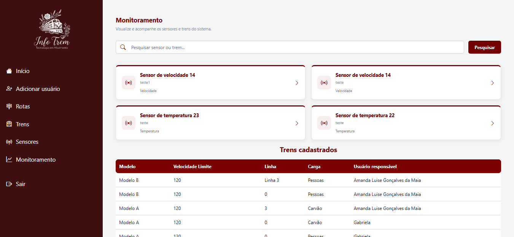

10.1. Pesquisa e visualização dos sensores
Na parte superior da tela existe um campo de pesquisa identificado como Pesquisar sensor ou trem. Esse campo permite localizar informações relacionadas a um sensor ou trem.

Clique no campo de pesquisa.

Digite o nome ou a identificação do sensor ou trem que deseja localizar.

Clique em Pesquisar para realizar a consulta.

Os cartões apresentados na tela exibem o nome do sensor, a descrição da localização e o tipo de dado monitorado. Cada cartão possui um acesso para visualizar os detalhes disponíveis.

10.2. Visualização detalhada do Sensor de velocidade 14
Para consultar informações específicas de um sensor, selecione o acesso de detalhes disponível no cartão correspondente. Na tela apresentada, o título identifica o equipamento como “Sensor de velocidade 14” e a faixa verde informa que ele está em “Operação normal”.

Na seção “Dados do sensor”, são exibidos o ID do sensor (#13), o nome do sensor (Sensor de velocidade 14), a descrição da localização (teste1) e o dado monitorado (Velocidade). Essas informações permitem identificar o registro, reconhecer sua localização descrita no cadastro e saber qual variável está sendo acompanhada.

A seção “Informações da rota” apresenta uma imagem ilustrativa do trajeto associado ao sensor e campos de identificação da rota, incluindo o nome da rota e a estação de origem. Os valores desses campos não estão totalmente visíveis na captura de tela fornecida; por isso, devem ser consultados diretamente no sistema.

Observação: a tela mostra “Sensor de velocidade 14” como nome do equipamento, enquanto o campo “ID do sensor” apresenta o número #13. O nome e o identificador são informações diferentes e devem ser considerados conforme aparecem no sistema.

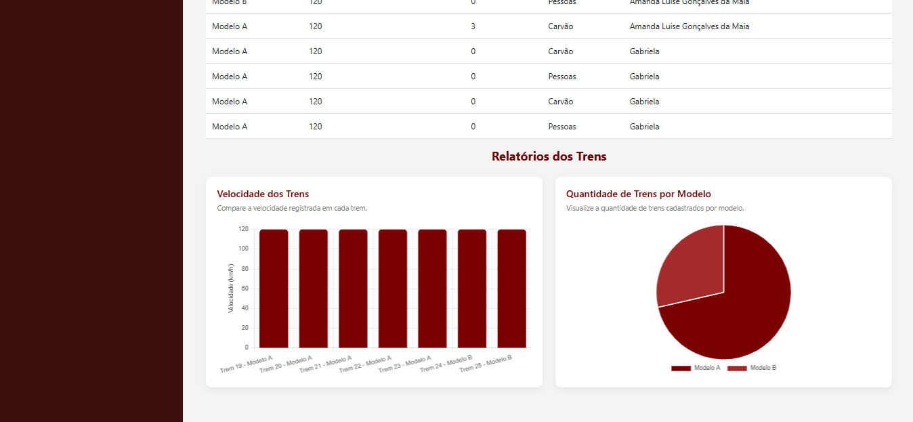

10.3. Trens cadastrados
A seção Trens cadastrados apresenta uma tabela com os trens registrados no sistema. Nela podem ser consultadas as seguintes informações:

Modelo: modelo do trem cadastrado.

Velocidade Limite: velocidade máxima registrada, em km/h.

Linha: linha ferroviária relacionada ao trem.

Carga: tipo de carga transportada.

Usuário responsável: pessoa vinculada ao registro do trem.
10.4. Relatórios dos trens
Na parte inferior da tela de Monitoramento são apresentados gráficos relacionados aos trens cadastrados:

Velocidade dos Trens: gráfico de barras que permite comparar a velocidade registrada em cada trem.

Quantidade de Trens por Modelo: gráfico circular que apresenta a distribuição da quantidade de trens cadastrados de acordo com o modelo.

Os gráficos auxiliam na visualização e comparação dos dados registrados no sistema. As informações exibidas dependem dos registros disponíveis.

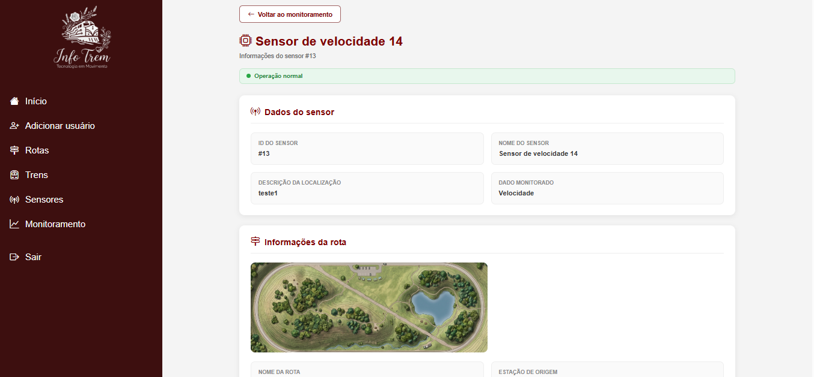

11. COMO REALIZAR O LOGOUT

O logout é o procedimento utilizado para encerrar o acesso ao sistema.

Localize a opção Sair no menu lateral.

Clique sobre ela.

Caso apareça uma mensagem de confirmação, verifique a solicitação.

Confirme o encerramento da sessão, se solicitado.

Aguarde o redirecionamento para a tela de acesso.

É recomendado realizar esse procedimento sempre que terminar de utilizar o sistema, principalmente em computadores compartilhados.

12. CONSIDERAÇÕES FINAIS

O perfil Administrador possui a responsabilidade de organizar e gerenciar as informações cadastradas no InfoTrem.

Por meio das funcionalidades apresentadas neste manual, é possível administrar usuários, trens, rotas e sensores, além de acompanhar os dados disponibilizados na tela de Monitoramento.

A utilização correta dessas funcionalidades contribui para manter os registros organizados e facilitar o acompanhamento das informações do sistema.

Em caso de dúvidas ou dificuldades durante a utilização, o administrador deverá entrar em contato com a equipe responsável pelo desenvolvimento e manutenção do InfoTrem.
