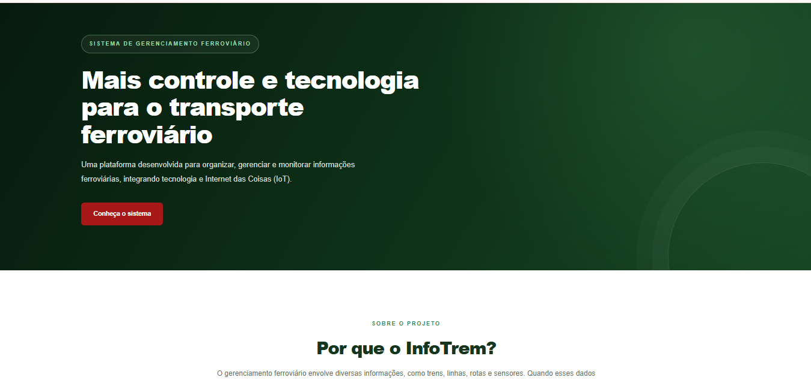
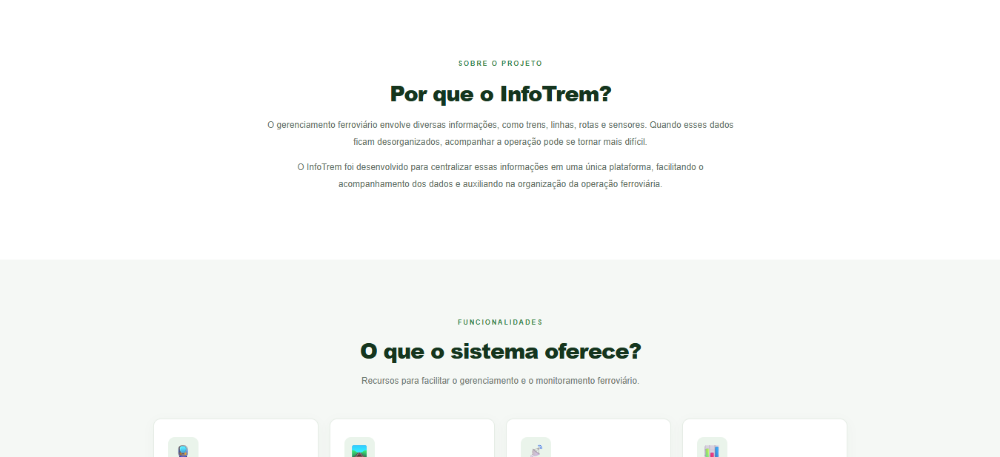
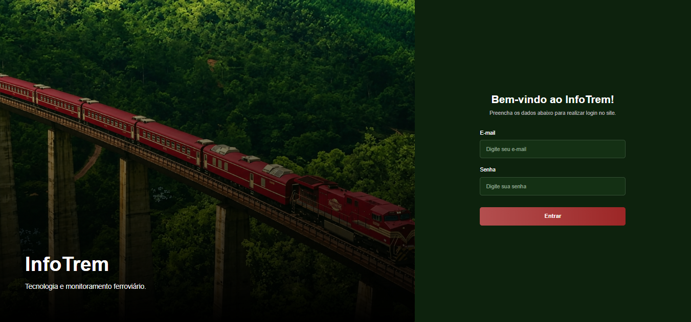
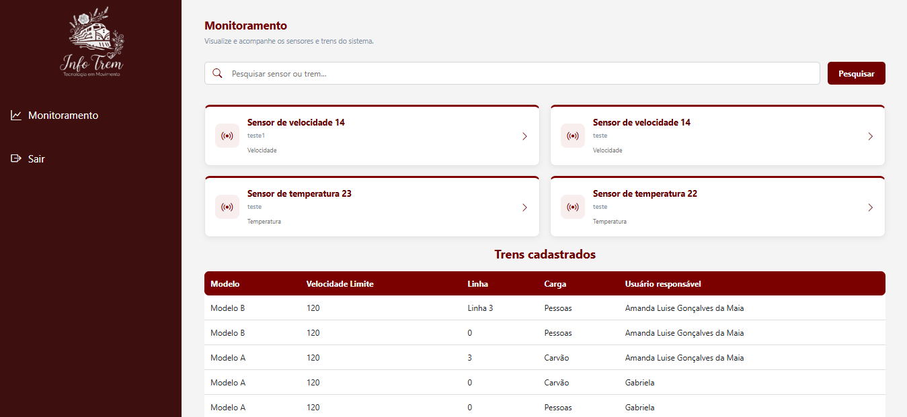
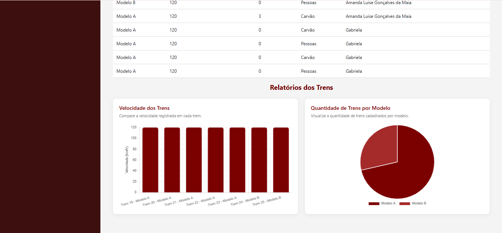

PARTE II — PERFIL USUÁRIO
MANUAL DE UTILIZAÇÃO

DO SISTEMA INFOTREM

PERFIL: USUÁRIO

Sistema: InfoTrem – Tecnologia em Movimento
Versão: 1.0
Ano: 2026

Joinville – SC

1. APRESENTAÇÃO DO SISTEMA

O InfoTrem é um sistema desenvolvido para auxiliar no gerenciamento e monitoramento ferroviário. A plataforma reúne informações relacionadas a trens, rotas e sensores, permitindo acompanhar os dados disponibilizados pelo sistema.

O sistema possui diferentes níveis de acesso, entre eles Administrador e Usuário. Cada perfil apresenta permissões específicas, de acordo com suas responsabilidades.

O perfil Usuário é destinado à consulta e ao acompanhamento das informações exibidas na área de Monitoramento. Este manual apresenta orientações para navegar nessa área, pesquisar sensores ou trens, consultar os registros apresentados e encerrar a sessão.

1.1. Página inicial pública (Landing Page)

Antes de realizar o login, o visitante pode visualizar a página pública do InfoTrem, também chamada de landing page. Essa página apresenta o propósito do projeto e explica, de forma resumida, a proposta da plataforma: organizar, gerenciar e monitorar informações ferroviárias com apoio de tecnologia e Internet das Coisas (IoT).

A página pública tem função institucional e informativa. Para acessar as funcionalidades restritas, é necessário entrar no sistema com uma conta cadastrada.

2. COMO ACESSAR O SISTEMA
O acesso ao InfoTrem é realizado por meio do XAMPP, que disponibiliza o servidor local necessário para executar o sistema no computador.
1. Abra o Painel de Controle do XAMPP.
2. Inicie os módulos Apache e MySQL, utilizados para executar o sistema e sua base de dados.
3. Verifique se os módulos iniciados aparecem como ativos no painel do XAMPP.
4. Com os serviços ativos, abra um navegador e acesse o endereço local configurado para o projeto InfoTrem.
5. Quando a tela de acesso for exibida, informe as credenciais da sua conta cadastrada.

3. COMO REALIZAR O LOGIN
O login identifica a pessoa que está acessando o InfoTrem e libera as funcionalidades correspondentes ao tipo de conta.

1. Na tela de acesso, localize o campo E-mail.
2. Digite o endereço de e-mail cadastrado para sua conta de usuário.
3. Localize o campo Senha e digite a senha correspondente.
4. Confira se as informações foram preenchidas corretamente.
5. Clique no botão Entrar.
6. Após a validação das informações, o sistema direcionará você para a área disponível ao seu perfil.
   Caso os dados estejam incorretos, o acesso não será realizado. Confira as informações digitadas e tente novamente.

4. CONHECENDO A TELA DE MONITORAMENTO
Após realizar o login, o usuário é direcionado à tela Monitoramento. Nessa área são apresentados cartões com sensores cadastrados, uma tabela com os trens cadastrados e gráficos que resumem informações dos trens.

4.1. Menu lateral
O menu lateral fica localizado no lado esquerdo da tela e apresenta as opções disponíveis para o perfil Usuário:
- Monitoramento: direciona para a tela de acompanhamento dos sensores e trens.
- Sair: permite encerrar a sessão atual no sistema.
  Para acessar a área de monitoramento, clique em Monitoramento. Para finalizar o acesso, utilize a opção Sair.

4.2. Campo de pesquisa
Na parte superior da tela existe o campo Pesquisar sensor ou trem. Ele permite localizar informações relacionadas a um sensor ou a um trem apresentado no sistema.
1. 1.Clique no campo Pesquisar sensor ou trem.
2. 2.Digite o nome ou a identificação do sensor ou trem que deseja localizar.
3. 3.Clique no botão Pesquisar para realizar a consulta.
4. 4.Confira as informações apresentadas na tela.

4.3. Cartões de sensores

Os cartões exibidos na área de Monitoramento apresentam informações resumidas dos sensores cadastrados. Nas telas disponibilizadas, cada cartão mostra:

- Nome ou identificação do sensor, por exemplo, Sensor de velocidade 14 ou Sensor de temperatura 23.
- Descrição da localização, conforme registrada no cadastro, como “teste1” ou “teste”.
- Tipo de informação monitorada, como Velocidade ou Temperatura.
- Um acesso indicado por uma seta, que permite abrir a visualização detalhada do sensor.

  Para consultar um sensor, localize o cartão desejado e selecione o acesso indicado pela seta. As informações disponíveis serão apresentadas na tela de detalhes.

5. CONSULTA DETALHADA DOS SENSORES

A consulta detalhada permite visualizar informações específicas de um sensor selecionado na tela de Monitoramento.
1. 1.Localize o cartão do sensor que deseja consultar.
2. 2.Confira o nome e o tipo de dado monitorado para identificar o equipamento correto.
3. 3.Clique no acesso de detalhes indicado pela seta no cartão.
4. 4.Na tela aberta, consulte os dados apresentados para o sensor e as informações de rota disponíveis.
5. 5.Após concluir a consulta, utilize a navegação do sistema para retornar à tela de Monitoramento.

   Na visualização detalhada documentada no sistema, a seção Dados do sensor apresenta informações de identificação, como ID do sensor, nome, descrição da localização e dado monitorado. Também pode ser exibida uma seção Informações da rota, com dados relacionados ao trajeto associado.
Atenção: o nome do sensor e seu ID são informações diferentes. Para identificar corretamente o registro, observe os campos apresentados na tela.

O conteúdo exibido depende dos dados cadastrados e disponíveis no sistema. Este perfil é destinado à consulta; as opções de cadastro, edição e exclusão pertencem às funções administrativas.

6. TRENS CADASTRADOS

A seção Trens cadastrados apresenta uma tabela com os trens registrados no InfoTrem. Ela permite consultar as principais informações associadas a cada registro.

Na tabela, podem ser consultadas as seguintes informações:
- Modelo: modelo do trem cadastrado.
- Velocidade Limite: velocidade máxima registrada para o trem, em km/h.
- Linha: linha ferroviária relacionada ao trem.
- Carga: tipo de carga transportada, como Pessoas ou Carvão, conforme os registros apresentados.
- Usuário responsável: pessoa vinculada ao registro do trem.
  Para consultar um registro, localize a linha correspondente e leia as informações nas colunas. Os dados exibidos dependem dos trens cadastrados no sistema.

7. RELATÓRIOS DOS TRENS

Na parte inferior da tela de Monitoramento são apresentados gráficos que auxiliam na visualização e comparação das informações dos trens cadastrados.

7.1. Velocidade dos Trens

O gráfico de barras Velocidade dos Trens compara a velocidade registrada para cada trem. O eixo vertical apresenta a velocidade em km/h e o eixo horizontal identifica os trens e seus respectivos modelos.

7.2. Quantidade de Trens por Modelo

O gráfico circular Quantidade de Trens por Modelo apresenta a distribuição da quantidade de trens cadastrados de acordo com o modelo. A legenda identifica as categorias exibidas, como Modelo A e Modelo B.

Os gráficos são recursos de consulta e oferecem uma visão resumida dos registros existentes. Os valores e as categorias apresentados podem variar conforme os dados cadastrados no sistema.

8. COMO REALIZAR O LOGOUT

O logout é o procedimento utilizado para encerrar o acesso ao sistema.
1. 1.Localize a opção Sair no menu lateral.
2. 2.Clique sobre ela.
3. 3.Caso apareça uma mensagem de confirmação, verifique a solicitação.
4. 4.Confirme o encerramento da sessão, se solicitado.
5. 5.Aguarde o redirecionamento para a tela de acesso.
   É recomendado realizar esse procedimento sempre que terminar de utilizar o sistema, principalmente em computadores compartilhados.

9. CONSIDERAÇÕES FINAIS

O perfil Usuário do InfoTrem permite acompanhar as informações disponibilizadas na área de Monitoramento, consultar os sensores cadastrados, visualizar os dados dos trens e observar os relatórios gráficos.

A utilização correta dessas funcionalidades facilita a consulta das informações operacionais reunidas no sistema. As operações de cadastro, edição e exclusão não fazem parte das funcionalidades apresentadas para este perfil.

Em caso de dúvidas ou dificuldades durante a utilização, o usuário deverá entrar em contato com a equipe responsável pelo desenvolvimento e manutenção do InfoTrem.